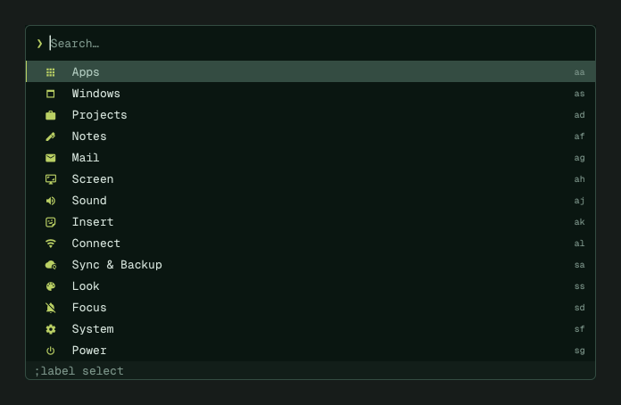
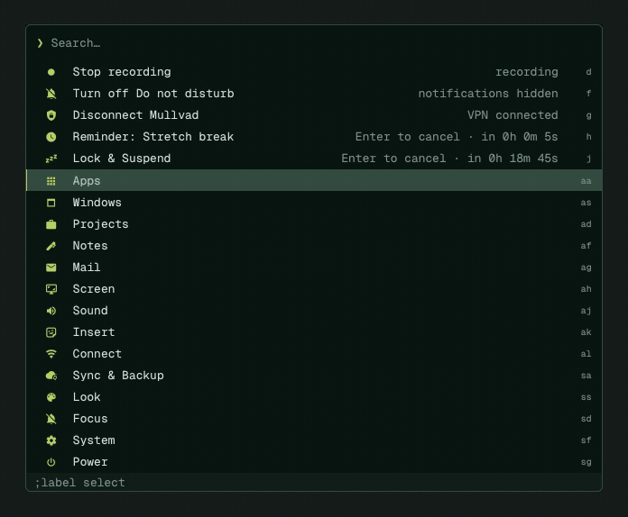
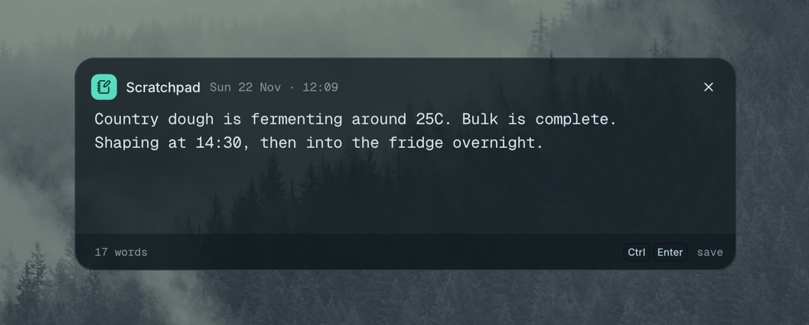
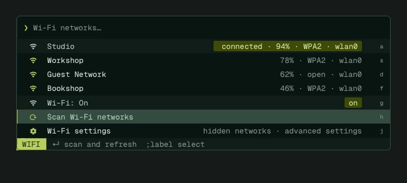
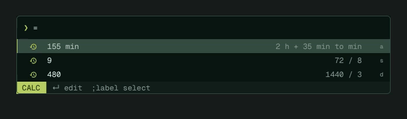
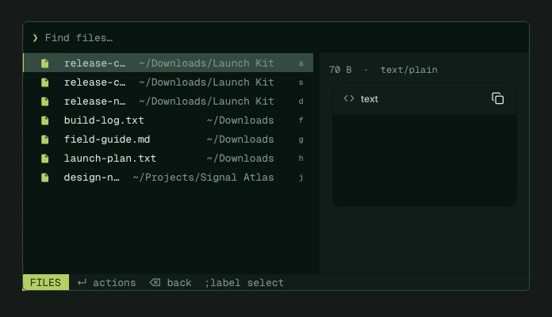

# Cloncher
It's a **Clo**jure lau**ncher**, but also it's a **C**launcher.

A keyboard-first Linux launcher for apps, files, and desktop actions. Built with [Jolt](https://github.com/jolt-lang/jolt) and [CUI](https://github.com/yappologistic/CUI).

## Where it came from (written by the human)

Cloncher started in the end of 2023, when I finally switched to Linux and breathed the air of freedom. I always was a keyboard oriented Emacs user, so naturally I wanted to customize the way things are done at the OS level. I tried more launchers than I care to remember or name, but there was always something wrong.

I couldn't style it the way I wanted. Or make it do one thing that I wanted. Or it wasn't fast enough. At some point I just used a launcher with a menu completely generated by my babashka (clojure) scripts, all I wanted from the launcher itself was just showing it in a pretty way. And it worked fine, except the search didn't look inside the menus, which was bugging me.

Past few months I started experimenting with a Rust front-end for my scripts, and was very happy with the result. I finally controlled how it worked, how it looked, how it themed, how fast it was. All in all it was an excellent prototype which I loved using. Out of it came Cloncher.

I rebuilt the clojure/rust monster it in Jolt (while experimenting with what else can now be built in Clojure), moved the menu tree into an EDN, and gave it its own repository so I can finally share my favorite launcher.

The bundled menus reflect the Niri, Noctalia, Kitty, and Emacs setup I use. You can keep account-specific actions and paths in your local EDN file, or replace the menu with a smaller setup of your own. If there are people who want to use it, I'll be glad to make it more general.

Another important point is that this project shows off how powerful Clojure is, when you give it access to C interop and a way to compile it into small, efficient, native binaries.

## Documentation (checked by the human)

I open Cloncher with Mod+Space. From that prompt I can search for an app or a menu action, type `/` to find a file, or type `=` to open the calculator. The same prompt can show nearby Wi-Fi networks, switch Niri windows, browse projects, and run custom commands.

[Watch the demos](#demos) · [Performance](#performance) · [Build it](#build-and-run) · [Make it yours](#configuration)



## Performance

I use Cloncher throughout the day. I want to hit Mod+Space and type in the same motion, so **16 ms is my budget for immediate feedback** when opening the menu, moving between views, or typing a query.

On my Niri desktop, 20 warm opens of the compiled launcher took **14.6 ms median, 16.8 ms at the 95th percentile, and 18.6 ms at worst**. I timed from starting the hotkey client to its first launcher buffer submission to Wayland. This measures an already-running daemon through frame submission. Display scanout and daemon startup are outside that measurement.

The daemon warms the window and fonts and caches commonly used rows. File search starts with cached recent files while the full index loads. Longer operations give immediate feedback where they start. A Wi-Fi scan, for example, shows a spinner in its own row while NetworkManager works.

## Demos

These are recordings of the compiled launcher with sample device states and files. Click any loop for its MP4.

### See what’s running from the main menu

Active reminders and sleep timers appear above Apps with their remaining time. Press Enter on a timer to cancel it. The same section can stop a screen recording, disconnect Mullvad, or turn off Do Not Disturb. Watch a reminder expire and the VPN disconnect while the menu stays open.

[](docs/media/live-menu.mp4)

### Keep a countdown or stopwatch on screen

Search for **Countdown** or **Stopwatch**, or open **Focus**. A countdown accepts a duration (`5m`, `1h 30m`, or a bare number in minutes) or the next occurrence of a clock time (`13:30`), then asks for an optional label. A stopwatch starts immediately. Starting either replaces the current on-screen timer.

The translucent card uses the launcher’s palette, updates when the theme changes, and stays in the upper right below the desktop bar’s reserved space. It’s a click-through Wayland layer-shell overlay, not a tiled or floating window. There is no regular-window fallback on X11 or Wayland compositors without layer-shell.

Select the active timer above Apps to pause, resume, restart, or close it. When a countdown finishes, the bell gives a gentle ripple every three seconds until dismissed or restarted. The card stays at zero and sends no desktop notification. **Remind me** still sends a notification.

With a running stopwatch selected, press **Ctrl+Enter** to record a lap, or choose **Record lap** in its controls. The card shows the latest split. **Lap history** shows each split and its cumulative time to the hundredth of a second. Paused time doesn’t count; restarting clears the laps.

### Jot a note into your scratchpad

Search for **Quick note**, open **Notes**, or bind a key to `cloncher note`. A translucent editor opens in the middle of the screen in the launcher's palette. Press **Ctrl+Enter** to append the note to your scratchpad under a heading with an inactive Org timestamp, such as `* [2026-11-22 Sun 14:05]`. Press **Esc** or the close button to discard it. If the file can't be written, the editor stays open with your text.



Set the file with a top-level `:scratchpad` path in your config, for example `:scratchpad "~/org/scratchpad.org"`. Like the timer, the editor is a Wayland layer-shell overlay. It takes the keyboard until you save or dismiss it.

### Wi-Fi stays in the menu

See signal strength, security, and the connected network at a glance. Start a scan and the spinner appears on the scan row itself. The result list refreshes in place when the scan finishes.

[](docs/media/wifi.mp4)

### Calculate and reuse an answer

Type `=` for the tape, or enter a calculation like `=256 MiB to MB`. Enter copies the current result. Pick a tape entry to bring its expression back into the prompt and edit it.

[](docs/media/calculator.mp4)

### Find a file, preview it, then choose an action

Type `/` to start with recent files. Narrow the list by typing, preview the selected file, and press Enter for actions such as Open, Reveal in Dired, or Copy path. Backspace from an empty search returns to the previous menu.

[](docs/media/files.mp4)

## A few good keys to know

| Key | What it does |
| --- | --- |
| Type at the root | Search apps and actions across searchable submenus. [Watch the menu demo](docs/media/navigation.mp4). |
| `;` then a row label | Jump to the labeled result. You can also hold Alt and type the label. |
| `/` · `@` · `=` | Open Files, Projects, or calculator history from the root. |
| `>` · `>>` · `>>>` | Enter a command or browse history for terminal or background execution. |
| `(` | Start a restricted desktop Lisp expression for actions such as finding and focusing a window. |
| Ctrl+Enter | Run the selected row's alternate action, where one is defined. |
| Backspace on an empty query · Esc | Go back from a nested view. Esc closes the root. |

Apps come from XDG desktop entries. Projects use Emacs's project list and can expose Babashka tasks, Just recipes, and Make targets. File search starts from a small recent-files cache while the daemon prepares the full index in the background.

## Build and run

The primary desktop is Linux with Niri. Cloncher opens as a layer-shell overlay where the Wayland compositor supports it, and uses an ordinary window on X11 or when layer-shell is unavailable.

On x86-64 Linux, `nix-shell` brings in Jolt, a C compiler, and common integration tools. With direnv hooked into your shell, `direnv allow` loads the same environment on entry. Run `jolt -Srepro -M:test` to verify the setup.

Building the CUI host currently requires access to my private CUI template checkout. Cloncher finds it in a sibling `jolt-poly-template` directory or via `CLONCHER_CUI_TEMPLATE`. If you already have a compatible `libcui_host.so`, point `CLONCHER_CUI_LIBRARY` at it for `jolt dev` or `jolt prod`. [Install Jolt without Nix](https://github.com/jolt-lang/jolt#install)

If your graphical session already uses the `launcher.service` systemd user unit, run:

```sh
jolt install
```

This builds the release, installs all three artifacts in `~/.local/libexec/cloncher/`, links `~/.local/bin/cloncher` to the hotkey client, and restarts `launcher.service`. It does not create or enable the unit. Bind Mod+Space to `~/.local/bin/cloncher` for this setup.

To build and run without the user unit:

```sh
CLONCHER_CUI_TEMPLATE=/path/to/jolt-poly-template jolt release
./target/cloncher-client
```

The release puts the client, application, and CUI host library together in `target/`. Keep all three together when installing them. For a source run, set `CLONCHER_CUI_LIBRARY` to the host library if Cloncher cannot find it.

Start the daemon from your graphical session and bind Mod+Space to the absolute path of `target/cloncher-client`.

```sh
./target/cloncher daemon
```

The hotkey client talks to the daemon through a private Unix socket. The daemon prepares the native window and fonts while idle, then attaches the overlay when you open it. Use `bin/cloncher ping`, `bin/cloncher close`, or `bin/cloncher screenshot /tmp/cloncher.png` from another terminal.

The integrations use the tools you already have. Install `qalc` for the calculator, `fd` for file indexing, and NetworkManager's `nmcli` for Wi-Fi. Wayland clipboard actions use `wl-copy`. PDF and video thumbnails use `pdftoppm` and `ffmpeg`. A Noctalia palette at `~/.config/launcher/colors.css` can theme the panel.

### Use it from a script

```sh
printf '%s\n' Alpha Beta | bin/cloncher dmenu -p 'Choose a line'
bin/cloncher menu wifi
bin/cloncher files
```

The picker returns the selected line on stdout and exits with status 1 on cancellation. `bin/cloncher secret -p 'Password'` opens a masked prompt. It keeps the response out of ordinary search history, and the daemon refuses screenshots of secret prompts.

## Configuration

First launch copies the [bundled menu](resources/cloncher/default.edn) to `$XDG_CONFIG_HOME/cloncher/config.edn`, usually `~/.config/cloncher/config.edn`. Later launches preserve your edits. Production reads valid changes on the next open and keeps the last valid config in the running process if an edit fails.

A menu is an ordered list of static rows and live providers. Here is a complete two-menu config.

```clojure
{:menus
 {:main
  {:prompt "Menu"
   :items [{:id :wifi
            :label "Wi-Fi"
            :action {:menu :wifi}}]}

  :wifi
  {:prompt "Wi-Fi networks"
   :items [{:provider :wifi/networks}
           {:id :wifi/scan
            :label "Scan Wi-Fi networks"
            :action {:call :wifi/scan}
            :refresh :current
            :progress "Scanning Wi-Fi networks…"}]}}}
```

Use `:exec` with an argument vector for commands, `:shell` for shell syntax, or `:terminal` for a command that needs a terminal. Set `:search` to add aliases, `:shortcut` to pin a row label, or `:searchable? false` on a submenu to keep its contents out of parent searches.

To configure Tailscale switching, add a top-level `:tailnets` vector to your local config. Each entry has string fields `:label` (menu name), `:tailnet` (name reported by `tailscale status --json`), and `:account` (argument accepted by `tailscale switch`).

## Develop in the open window

Build the host once with `bin/build-cui` or export `CLONCHER_CUI_LIBRARY` before launching.

```sh
jolt dev
jolt eval desktop --ns user -e '(cloncher.dev/show! :files)'
jolt eval desktop --ns user -e '(cloncher.dev/reload-config!)'
jolt eval desktop --ns user -e '(cloncher.dev/screenshot!)'
```

The tiled dev host stays open while you turn its embedded launcher on and off. You can inspect its state, open a view with fixture rows, reload code with `cloncher.dev/reload!`, and capture the result without closing the window. Dev previews stop at the point where a production action would run. The [session state machine](src/cloncher/machine.clj) and [panel](src/cloncher/view.clj) are shared with the production overlay.

```sh
jolt -Srepro -M:test
```

If you try Cloncher on another Linux setup, I'd especially like to hear which parts worked out of the box and which still assume my desktop.

## License

Cloncher is licensed under the GNU General Public License, version 3 only (`GPL-3.0-only`). [Full license text](LICENSE)

If you fix a bug or improve an integration, please send a pull request upstream so everyone can use it.
